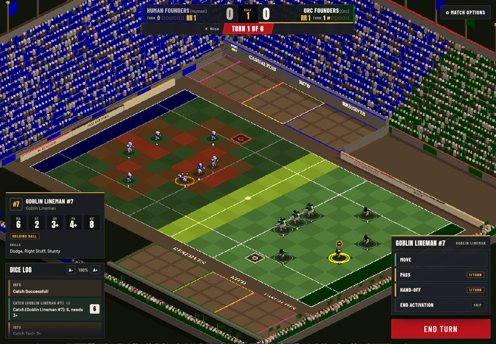
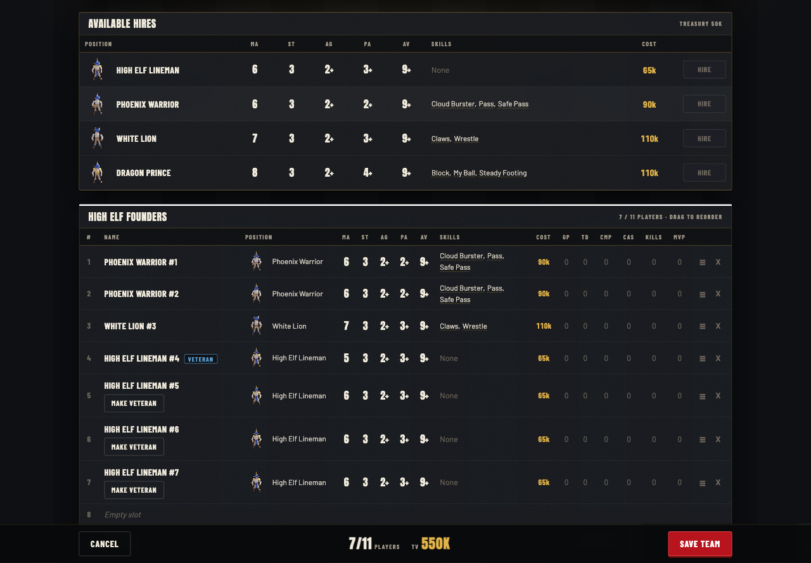

# Blood Bowl Sevens

A browser game of seven-a-side fantasy football. Build a team, play a local
match with another coach, and carry your players through leagues and tournaments.
Animated sprites play on an isometric pitch, with a React HUD for actions,
dice and coaching decisions.

[Play the game](https://bloodbowl-sevens.joe-lloyd.com/) ·
[How to play](docs/PLAYING.md) · [Documentation](docs/README.md)



## What you can play

- Local matches for two coaches sharing a screen, with saved-match resume
  and no account required.
- Team building across 30 rosters, including the updated High Elves,
  Bretonnians and Tomb Kings. Hire players, choose team colours and manage
  development and career statistics.
- Complete match flow from coin toss and setup through kick-offs,
  movement, blocking, passing, fouling and post-match results.
- Leagues and tournaments, with Matched Play, Sevens Skill Selection and
  Advanced League team modes.
- Online hosting and joining by code, cloud teams and match chat when
  Firebase is configured and both coaches sign in.
- Blood Bowl and Neon stadium styles, with camera zoom and pan.



## Run it locally

Use Node.js 20.19+, 22.12+, or 24+ and pnpm 10.26.0, the version pinned in
[package.json](package.json).

```bash
pnpm install --frozen-lockfile
pnpm dev
```

Open the address Vite prints. Start with **Build Team**, create two legal
teams, then choose **Play Local**. Firebase configuration is optional for
local play. See the [development guide](docs/DEVELOPMENT.md) for tests,
builds and online setup.

## The engine behind the game

The same TypeScript rules engine drives the browser, the terminal interface
and deterministic match simulations. Scenario tests exercise individual rules;
recorded simulations help reproduce interactions across whole matches.

```bash
pnpm exec vitest run    # unit and headless tests
pnpm e2e:engine         # deterministic scenario matrix
pnpm headless           # interactive terminal game
pnpm sim --games 10      # simulated matches with recorded findings
```

See [testing](docs/technical/testing-guide.md),
[simulations](docs/SIMULATION.md) and [architecture](docs/technical/architecture.md).

## Project status

This is a playable fan project under active development. It implements a
20 × 11 Sevens pitch and six turns per coach per half, using the 2025 rules
as its baseline. There are known rules and online-play gaps. The
[status page](docs/STATUS.md) names them and links to the evidence.
A [computer coach](docs/technical/computer-coach.md) can take Player 2 at
Standard, Hard or Legend difficulty.

## Credits and references

Blood Bowl and its team names belong to Games Workshop. This project is
unofficial and is not endorsed by Games Workshop.

The repository does not distribute the official rulebooks or extracted
chapters. Developers can keep their own reference copies in ignored local
folders. Public skill tooltips use short project-written hints. See
[private references](docs/DEVELOPMENT.md#private-reference-material).
